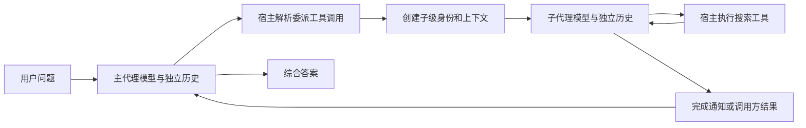
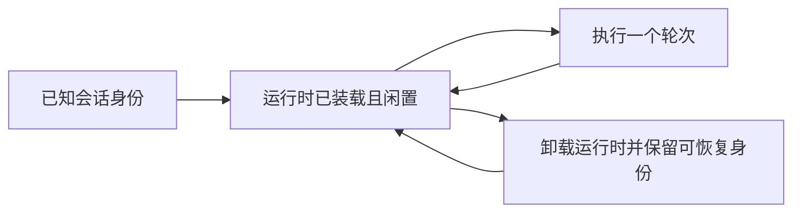

# Codex 与 DeepSeek Harness：多智能体架构对比与实现思路

本文可以独立阅读。目标是解释两套实现如何让多个模型执行上下文协作，以及相同工具名称背后的不同合同。源码链接用于核查，不是理解正文的前提。

比较基线为 Codex `b337fe06` 的本地 V2 路径，以及 DeepSeek Harness `687f282e` 的普通 subagent 和实验性 Agent Team。V1
只在兼容差异处涉及。以下实现结论来自静态源码核对；案例属于教学推演，没有声称运行过两套上游系统。

## 1. 先建立一个共同的执行模型

一个模型通常只负责“根据当前输入，输出下一段文字或下一次工具调用”。模型说“请创建研究员”时，并没有直接创建进程、会话或网络连接。宿主程序收到工具调用，才执行这些副作用。

最小的多智能体系统可以拆成五个责任：

| 责任       | 需要解决的问题                         | 简单搜索协作中的例子                           |
|------------|----------------------------------------|------------------------------------------------|
| 模型决策   | 下一步是否委派、委派什么、如何综合     | 主代理决定把 Alpha 和 Beta 的资料调查分开      |
| 上下文构造 | 每个代理本轮究竟看见哪些消息和工具     | Alpha 研究员只接收自己的任务或父方历史快照     |
| 执行控制   | 创建、运行、等待、继续、取消哪一个代理 | 宿主创建研究员会话，驱动其模型与搜索调用       |
| 协作协议   | 身份、消息、完成结果、任务状态如何表达 | “Alpha 研究已完成”和“请再核对发布时间”分别传递 |
| 状态与资源 | 哪些数据持久化、哪些执行占用容量       | 会话历史保留，闲置运行时可卸载，活跃执行受限   |



上图的两个“模型”可以使用同一个服务商和模型，也可以不同。关键是它们具有各自的输入历史与执行状态。多个并发 HTTP
请求可以成为实现的一部分；代理协作还需要规定任务、身份、消息和结果如何关联。

## 2. 两套系统分别把复杂度放在哪里

### Codex：围绕会话线程的控制面

Codex 的本地 V2 从一个主线程发展出有层级路径的子线程，例如 `/root/alpha` 和 `/root/beta`。每个子线程可以有自己的历史，并在授权和配置允许时继续委派。

模型通过 `spawn_agent`、`send_message`、`followup_task`、`wait_agent` 等工具表达意图。工具处理器把这些请求交给
`AgentControl`。本地后端再负责身份解析、线程装载、消息投递、执行计数、驻留资源和完成通知。

可以把它理解为一个“会话控制服务”：先保证可找到正确代理、把正确输入送进去，并让执行结果回到正确接收方。本文所读主链没有独立的共享任务认领领域对象。主代理可以用任务文本分工，但框架不会因此生成带
owner、revision 和依赖边的任务板。

### DeepSeek Harness：通用委派服务加可组合的团队层

DeepSeek Harness 的普通委派由 `SubagentRuntime` 提供统一入口。执行后端通过 `SubagentProvider` 注册，生命周期由
`SubagentManager` 管理。模型工具和 workflow 都能消费这一能力。

一个后端可以创建本地、可续接的子会话；另一个后端可以启动外部的一次执行。调用方都得到受管理的 activation，但它们支持的后续消息和恢复能力不同。

Agent Team 在上述本地子会话上增加具名 roster、成员权限、共享任务 DAG、持久事件和派生视图。它复用已有执行能力，将“这些代理一起承担哪些任务”单独建模。

因此研究时有两个层次：普通 subagent 解决“把工作委派出去”；Team 再解决“成员和任务如何形成可持续协作关系”。workflow
则提供程序化控制阶段与结果的另一种消费者。

## 3. 完整对照表

| 维度           | Codex 本地 V2                                                                               | DeepSeek 普通 subagent                                     | DeepSeek Agent Team                                        |
|----------------|---------------------------------------------------------------------------------------------|------------------------------------------------------------|------------------------------------------------------------|
| 核心身份       | ThreadId、父子关系、AgentPath                                                               | child Session 或外部执行身份                               | root Session 派生的 TeamId、Lead、具名成员                 |
| 创建入口       | `spawn_agent` 经共享 thread-spawn 路径                                                      | `startActivation` 按 Provider 分派                         | `spawn_teammate` 经 Team roster 再创建本地 continuation    |
| 历史选择       | `fork_turns=none/all`                                                                       | 取决于 Provider，代表实现为 in-process spawn/fork          | fresh/fork 选配置的本地 Provider                           |
| 模型参数       | 子配置继承并应用可用的覆盖项                                                                | Provider 能力允许时覆盖 route options                      | 经配置的 Provider 与 Team 工具传入                         |
| 后续消息       | QueueOnly 与 TriggerTurn 分离                                                               | 本地 continuation 支持相邻消息；外部一次执行不提供同等入口 | 经 Team 身份检查后路由给 Lead 或 teammate inbox            |
| 闲置目标       | `send_message` 不启动新轮次；`followup_task` 可启动                                         | 允许的本地消息可启动轮次，子级可冷恢复                     | Steer 可启动或冷恢复 inactive teammate                     |
| 等待结果       | V2 wait 返回通用等待状态 receipt，含 `message`、`timed_out`；正文经正常输入路径另行到达模型 | activation 的 `result` 或父级通知，取决于 delivery         | wait 等 Team 变化，随后重新读取状态                        |
| 完成结果接收者 | 父方及任务发起方的相应通知路径                                                              | `parent` 或 `caller` 两种交付方式                          | 成员消息与子代理机制；任务完成需另更新任务板               |
| 共享任务板     | 所读 native 主链没有等价对象                                                                | 不自动建立                                                 | 有 status、owner、revision、blockedBy 和提示性 writeScopes |
| 共享讨论       | 可选 Message Board：频道、帖子、回复、订阅                                                  | 可通过现有消息能力协作                                     | Team peer 消息；任务板另有领域状态                         |
| 持久化重点     | 线程历史、关系及可恢复身份；本地未消费 mailbox 另有内存边界                                 | descriptor、目录、子会话及消息按具体交付/恢复路径处理      | Lead 日志保存 roster/task，目标 Agent 保存自己的消息       |
| 并发控制       | 执行计数和驻留容量分开；不是共享任务队列                                                    | activation 树共享容量池                                    | 同时受普通 activation 能力和 Team 成员/任务上限约束        |
| 工作目录       | 由线程配置和环境管理决定，不能仅由树形路径推断隔离                                          | Provider 与 cwd 规则决定                                   | 当前 Team 包采用共享 checkout，不提供独立成员 cwd          |
| 扩展方式       | 配置、工具 handler、AgentControl 后端等具体边界                                             | 插件服务、Provider 与工具消费者                            | 在通用委派之上增加实验性领域服务和模型工具                 |

这张表比较的是机制，不是效果排名。源码结构不能证明哪套系统搜索质量更高、更省 token 或更快；这些需要在同一实验条件下测量。

## 4. 上下文：独立、继承和共享分别指什么

设主代理已经知道“用户只接受官方来源”，并且刚刚查过 Alpha 的主页。此时创建 Beta 研究员，有两个常见选择。

**Fresh：**子代理有独立的初始历史，主代理需要在任务中明确告诉它研究目标和来源约束。它不会因为共享文件目录，就自动读到父方刚才的模型对话。

**Fork：**子代理从父方历史的某个受支持快照开始，随后沿自己的执行分支继续。它可以看到快照内的约束和已知资料；父方未来新增的消息不会自动成为子方历史的一部分。

两套实现的快照细节不同。Codex V2 的 `all` 走完整历史 fork，并处理 child 身份对应的开发者提示。DeepSeek 的代表性 in-process
fork 捕获父方最近完整 `turn/end` 的历史前缀。后者刻意以已完成轮次作为边界，避免把尚未完成的父轮次直接当成完整子级输入。

这两种“继承历史”都不应被解释为复制所有运行时对象。需要分开看五项：

| 项目                 | 应如何理解                                           |
|----------------------|------------------------------------------------------|
| 对话历史             | 子级模型输入的快照与后续独立增长                     |
| persona / 开发者指令 | 由角色、配置和组合规则构造；可能替换父级身份提示     |
| 工具与权限           | 由子级配置、Provider 能力、宿主授权和工具注册决定    |
| 文件与服务           | 可能仍使用相同 checkout、MCP 服务和基础设施          |
| 活跃执行资源         | 本轮模型请求、取消信号、锁、容量槽具有自己的生命周期 |

对 Python 读者而言，“给两个对象传入同一个目录路径”和“让两个对象使用同一个消息列表”是不同操作；消息列表复制也不等于复制列表元素背后的全部外部资源。这里的类比只帮助识别概念，具体共享范围仍由各实现合同决定。

搜索实验的直接影响是：fresh 更依赖任务描述完整，fork 更容易携带既有背景。fork
也会携带无关历史和父方已有判断，可能增加输入量或引入确认偏差。后两点是待实验验证的设计推断，不是本次已测得的效果。

## 5. 生命周期：身份存在、运行时驻留、正在工作

“一个代理还在不在”至少有三种含义：它是否仍有合法身份、它的运行时是否装载、它当前是否有模型轮次执行。

例如 Alpha 研究员完成了一次任务，它仍可能保留会话身份和历史。宿主可以继续保留闲置运行时，也可以卸载它，稍后再恢复。此时“当前没有执行”不能被解释为“已经删除”或“失去所有历史”。



这是教学用的状态维度图，不是某一仓库所有枚举值的逐字转录。Codex 的 registry、residency 和 execution 分别处理其中不同责任。DeepSeek
还用 activation 表达一次受管理执行，稳定的子会话与某一次 activation 不是同一个生命周期单位。

Team 又增加一条持久建员维度：成员先 `provisioning`，之后成为 `active` 或 `failed`。一个持久 phase 为 `active` 的成员可以正在运行，也可以
inactive。任务板所显示的 owner 同样不会因为成员停止一个轮次就自动消失。

这些分层使系统能够保留已经取得的研究成果，同时释放昂贵运行资源；代价是“列举成员、查看运行状态、查看任务状态”需要分别读取对应事实。

## 6. 消息：四个不同的完成时点

一条“请再确认发布时间”的消息，有四个经常被混淆的时点：

1. **接收：**宿主接受了发送请求，目标 inbox 或 mailbox 已有这条输入。
2. **持久化：**相关输入或历史已经通过该路径的存储规则保存。
3. **模型可见：**目标在某个步骤边界或后续轮次把消息纳入输入。
4. **任务完成：**目标模型执行完请求并产生结果。

工具返回成功通常只说明合同中约定的前几个时点，不直接保证第四个。

### Codex 的两个消息动词

`send_message` 使用 QueueOnly：用于给目标留下消息，不替闲置目标启动工作。目标正在运行时，消息可在输入处理边界进入它的工作流；目标闲置时，主代理若希望它马上执行新任务，应使用
`followup_task` 的 TriggerTurn 语义。

`wait_agent` 等的是输入活动，返回只有 `message` 和 `timed_out`
的通用等待状态。它报告等待完成、被新输入中断或超时，不列举哪个子级完成，也不汇总结果。模型可读的完整正文通过正常消息注入路径另行到达；一次
wait 返回不能被当成“已经取得所有子级最终答案”的同步 RPC 响应。

### DeepSeek 的本地与 Team 消息

普通本地 continuation 消息具有父子邻接授权；Team 在此之上解析合法成员，并经 Lead authority 路由 peer 消息，同时保留真实发送者归属。

现行 Team 消息尝试 Steer：running 目标在步骤边界接收，inactive 目标可以启动或冷恢复。返回 `MessageId` 表示 inbox
接受，不表示模型已处理，也不代表 Team 为这条消息额外完成了一次同步存储 flush。

Team 的任务/roster journal 与目标 Agent 的 inbox 各有自己的持久化责任。历史 Team mailbox 记录仍可读取，但当前 Team
不再把新发送写成旧的 queued/delivered 日志，也不提供新的重发去重协议。

### 完成通知包含什么

子级最终答案、整个子级历史、所有工具结果和任务结束状态，是四类不同信息。Codex 本地完成路径会根据 outcome 组织向父方的 result
message；DeepSeek 的 settlement notice 会组织结束原因、closing text，并按实际结果附带结构化内容或诊断。它们不自动把子级全部搜索过程原样复制给父方。

DeepSeek 本地 continuation 还会收到明确指导，应使用 `send_message`
发送自包含结果。显式报告和宿主结算通知可以承担不同角色：前者传递正在影响计划的证据，后者报告该次执行如何结束。搜索任务设计应保证最终比较所需的来源与条件确实进入父方可见内容，不能只假定“代理结束了，所以所有搜索证据已经共享”。

### 为什么这个差异影响搜索协作

假设研究员已经闲置。主代理发出补查请求后就等待：在 Codex V2 中，仅 QueueOnly 消息不会自动开始补查；在 DeepSeek Team 中，合法的
Steer 消息可以唤醒该研究员。照搬工具名称会造成“系统没报错，但没有工作开始”的逻辑错误。

## 7. 任务板：把共享认领变成版本化状态

DeepSeek Team 的任务板为团队共享的计划提供持久事实。例如：

```text
task-1：调查 Alpha
task-2：调查 Beta
task-3：综合两者，blockedBy = [task-1, task-2]
```

每个任务从 revision 1 的 `pending` 开始。合法成员可以读取任务；认领操作需要依赖已完成、任务当前可认领，并提交它读到的
expected revision。成功后任务进入 `in_progress`，记录 owner，revision 增加。

若两个成员同时读到 `task-1@revision=1`，先成功的更新把它推进到 revision 2；另一个仍携带 revision 1
的更新会被拒绝。这个机制使陈旧修改显式失败。成员需要重新读取，再依据新状态决定下一步。

依赖 DAG 负责回答“哪些任务已经具备执行前提”；owner 负责表达“谁承担这项工作”。它们都不会自行让模型去搜索。真正的执行仍来自创建成员时的任务输入、后续消息，以及成员自己的模型决策。

`task-1` 的代理自然结束，也不会单凭这件事把 `task-1` 标记完成。模型需要通过 task 工具作出相应更新。若某个 owner
被中断，其任务归属也不会自动释放。

对于文件任务，`writeScopes`
只提供预计触及路径及重叠警告。它不阻止两个代理写同一个文件，也不创建独立工作树。搜索实验主要产生证据和答案，通常可以先用简单委派；当确有多个成员共同认领、任务依赖或复用计划的需求时，再评估任务板的收益。

## 8. 等待、并发、预算和持久性分层

### 等待不负责调度所有任务

Codex V2 的 wait 主要等待 mailbox/输入活动。DeepSeek Team 的 wait 主要等待成员状态、任务或消息变化；调用方随后重新读取状态。两者都不能被理解为共享任务执行器。

“没有新消息”也不等于“子代理没有运行”。搜索网络请求、模型采样和工具执行可能正在进行。观察接口需要区分工作仍活跃、已经闲置、未装载和超时。

### 并发上限需要先确定计数单位

Codex V2 分别管理驻留子线程和活跃子轮次。当前本地执行准入把容量检查与 running
计数分开，接口明确说明检查不原子预留容量；因此不能把它讲成一个严格原子信号量或公平排队调度器。

DeepSeek 普通 subagent 对 activation 树共享容量池，新建与冷恢复消耗容量，释放完成后归还。Team 的 `maxMembers` 又是 roster
的成员数量约束，不能当成同时模型请求数。

并发限制还不同于累计创建数量、模型 token 预算、单次搜索请求并发和工具超时。搜索评测必须分别记录这些条件，否则很容易把“允许更多预算”误认为协作机制更好。

### 保存历史不等于一切消息都具有持久队列保证

| 数据         | Codex 本地 V2 关注点                    | DeepSeek Team 关注点                    |
|--------------|-----------------------------------------|-----------------------------------------|
| 对话历史     | 线程 rollout 与历史提交路径             | 各 Agent 的 Session 日志                |
| 关系/成员    | 线程关系、registry 与可恢复身份         | Lead 日志里的 roster                    |
| 尚未消费消息 | 本地 mailbox 有内存操作与所有权转移边界 | 目标 Agent inbox 按正常策略接收和持久化 |
| 团队任务     | 所读主链没有对应共享任务领域状态        | Lead 日志里的完整 task 快照与 revision  |
| 客户端视图   | 根据相应线程/消息状态显示               | 从 journal 派生 roster/task projection  |

判断崩溃恢复时，应沿着“发送成功之前写了什么、什么时候 flush、目标何时把内容提交历史”逐段检查。Codex 本地完成通知接口还明确是
best effort，不承诺去重；DeepSeek Team 也不为新 peer 消息保存发送意图或提供重试去重。两者都不能仅凭“支持会话恢复”就推导出任意通知
exactly-once。

Codex 的更细时点也值得注意：输入写入内存 history 后会标记 delivery consumed，随后才尝试持久化 rollout；写入失败不会回滚前两步。DeepSeek
普通子代理的 settlement 通知同样有检查父实例、捕获投递错误并记录日志的路径。完整报告需要描述这些真实边界，不能用“持久会话”概括为所有消息都可靠送达。

## 9. 三个失败场景帮助理解实现取舍

**场景一：补查消息已经接受，目标没有开始新工作。**先检查目标是否闲置、调用用了 QueueOnly 还是 TriggerTurn。对 Codex V2，更换为正确的
follow-up 动作是协议层修正；不断增加 wait 超时不会改变目标轮次状态。

**场景二：两位成员认领同一任务。**DeepSeek 的 expected revision 使陈旧更新失败。这个错误让调用者重新读取共享事实，而非覆盖另一位成员的
owner。它解决任务元数据冲突，文件锁和外部业务写入的并发保证仍由各自边界提供。

**场景三：宿主在创建 teammate 中途退出。**Team 已记录 provisioning，并能结合独立 child 日志确认是否存在合法直接子级、continuable
descriptor 和已保存的初始输入，再形成 active/failed。这里的恢复依据是已写入的证据，不是“没收到异常就默认创建成功”。

这些例子解释了为什么一个可靠的多智能体系统需要超出 prompt 文本的宿主协议。主代理可以决定计划，宿主必须准确实现身份、授权、消息状态和生命周期。

## 10. 对 WisePen 的研究启示

以下是基于上述机制的研究判断，不是本次已经实现的功能。

1. 第一段可验证能力可以只覆盖主代理创建 fresh 子级、子级使用既有搜索工具、结果带来源返回父方。它已经足以研究任务描述、并行调查和综合效果。
2. 上下文历史与工具授权应作为两个问题处理。子级拿到某段父方文字，不代表它获得所有父方工具和权限；反之，fresh
   子级也可以被宿主授予既有搜索能力。
3. 明确区分消息、follow-up 与完成结果，避免父方把“对方收到了”当成“对方做完了”。选择何时唤醒，是运行合同。
4. 是否采用共享任务板，取决于是否真的需要认领、依赖和持久计划。先写清这些需求，再选择领域模型；讨论消息板和任务板可以独立评估。
5. 沿用本项目正常的 Nacos、Mongo、Kafka、Redis 等基础设施。研究重点是多代理执行和协作合同；当前实验不依赖 RAG/Sandbox 两个业务服务。

已有 `ToolScope`、`McpRemoteTool`、搜索 MCP 与工具输出缓存可作为能力基础。未来研究需另外回答子级会话身份、执行归属、消息进入模型的时点和结果来源如何对应，而不是把多代理全部塞进某一个搜索工具。

## 11. 本文对应的源码证据

- Codex 的身份、控制、mailbox 与执行合同：[AgentControl](codex/codex-rs/core/src/agent/api.rs)。
- Codex
  的消息动词：[send_message](codex/codex-rs/core/src/tools/handlers/multi_agents_v2/send_message.rs)、[followup_task](codex/codex-rs/core/src/tools/handlers/multi_agents_v2/followup_task.rs)、[wait](codex/codex-rs/core/src/tools/handlers/multi_agents_v2/wait.rs)。
- Codex
  的并发和驻留：[execution](codex/codex-rs/core/src/agent/control/execution.rs)、[residency](codex/codex-rs/core/src/agent/control/residency.rs)。
- DeepSeek
  的普通委派合同：[SubagentRuntime](deepseek-harness/packages/subagent/subagent/src/index.ts)、[Provider 与 activation 类型](deepseek-harness/packages/subagent/subagent/src/types.ts)。
- DeepSeek
  的团队层：[TeamService](deepseek-harness/packages/experimental/agent-team/src/index.ts)、[roster](deepseek-harness/packages/experimental/agent-team/src/roster.ts)、[task board](deepseek-harness/packages/experimental/agent-team/src/task-board.ts)、[journal](deepseek-harness/packages/experimental/agent-team/src/journal.ts)。

完整的实现入口、测试语义和行号保留在 [Codex 专篇](02-codex-multi-agent.md) 与 [DeepSeek 专篇](03-deepseek-multi-agent.md)
。建议先读完本文建立比较框架，再读各自专篇理解一套实现内部的顺序和状态。
