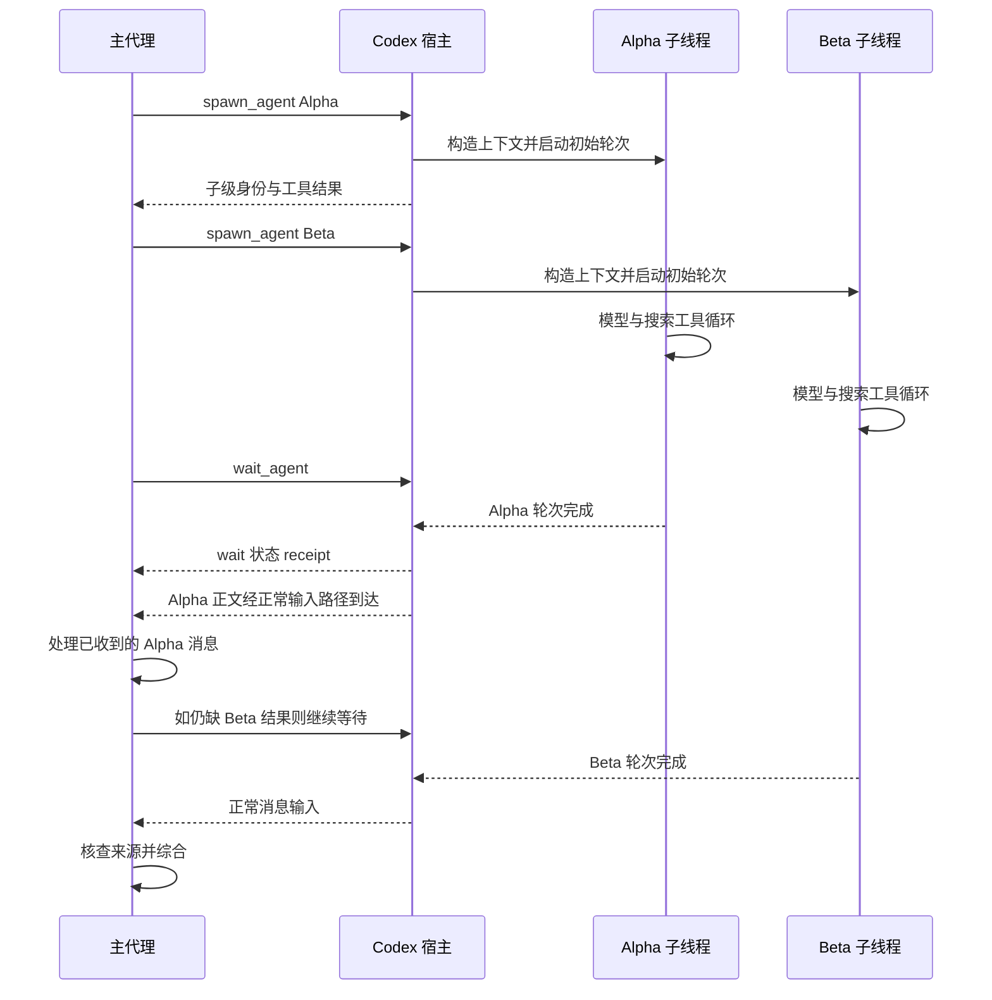

# 用同一个搜索任务理解两套协作机制

这是一份教学推演，可以直接阅读，不要求先打开源码。Alpha、Beta 是虚构项目，任务内容与消息正文均为示意；本次没有执行这些搜索，也没有为
WisePen 实现多智能体工具。真正开展实验时仍使用现有搜索服务和正常基础设施。

## 1. 同一个目标，三个工作单元

假设用户提问：

> 比较 Alpha 与 Beta 对并发任务和失败恢复的处理方式。每项结论给出官方来源，分清文档已经确认的行为与仍不明确的地方。

主代理将工作拆成：

| 工作单元      | 输入                                 | 期望交付                       |
|---------------|--------------------------------------|--------------------------------|
| A：Alpha 调查 | 用户问题、仅官方来源约束、Alpha 范围 | 并发/恢复事实、来源、未解问题  |
| B：Beta 调查  | 同样约束、Beta 范围                  | 同一结构的调查结果             |
| C：交叉综合   | A、B 的结果及原始用户问题            | 按相同维度比较，核查冲突和缺失 |

A 与 B 可以并行。C 在逻辑上依赖两份调查结果。这个依赖先存在于计划里；只有采用共享任务板时，它才进一步成为 `blockedBy`
这样的框架状态。

“创建三个模型”不会自动建立这些关系。主代理需要提供清晰任务，宿主需要建立身份、上下文和执行，最终还需要有人把成果综合起来。

## 2. 创建前决定 fresh 还是 fork

主代理已经知道用户要求官方来源，也可能看过一些 Alpha 资料。它可以这样选择：

### Fresh 研究员

初始输入应把必要约束写完整，例如：

```text
负责调查 Beta 的并发任务与失败恢复。
只使用官方文档和源码仓库；保留能支撑各项事实的来源。
分别报告并发限制、任务失败、中断后是否能恢复，以及尚不明确的问题。
不要调查 Alpha，也不要提前给出两者的优劣排序。
```

研究员获得自己的历史。它可以由宿主配置获得搜索工具，但不会因为拿到了工具就自动知道主方之前谈过什么。

### Fork 研究员

研究员从受支持的父方历史快照开始，再接收本次专门任务。它可能直接看到“仅官方来源”的先前约束，任务文本仍应明确 Alpha/Beta
的职责边界。

Codex V2 的完整历史 fork 与 DeepSeek in-process fork 的已完成 turn 前缀存在不同边界。两者都让子方之后独立推进；父方稍后发现的新证据需要通过显式消息或后续输入传递。

在这个例子中，两个 fresh 研究员是足够清晰的起点。将 fresh 与 fork 的效果比较留给下一轮实验，可以减少混杂因素。这是实验建议，不是源码证明的质量结论。

## 3. Codex V2：主代理拥有分工和综合过程

以下动作使用模型可见协作工具的实际名称，但不是可直接粘贴运行的完整 API 示例。模型能否看到工具及其参数，以宿主最终注册的
schema 为准。

| 时点 | 主代理/宿主动作                            | 状态与可观察结果                                                                     |
|------|--------------------------------------------|--------------------------------------------------------------------------------------|
| T1   | 主代理调用 `spawn_agent` 创建 Alpha 研究员 | 宿主解析参数、构造子配置与上下文，登记路径并启动初始任务                             |
| T2   | 再创建 Beta 研究员                         | 两个研究员各有自己的会话和历史；容量允许时可以同时推进                               |
| T3   | 工具调用返回子级身份                       | 返回不代表调查已经完成；主方可以继续规划综合维度                                     |
| T4   | 子级分别调用搜索工具                       | 每次真实搜索由各自宿主工具路径执行，结果进入对应子级历史                             |
| T5   | 某个研究员完成一轮                         | 完成结果/活动按本地控制路径通知相应接收方                                            |
| T6   | 主代理调用 `wait_agent` 等待活动           | wait 返回通用状态 `message`、`timed_out`；完整消息通过正常输入路径另行进入主方上下文 |
| T7   | 主代理读到调查结果                         | 才能检查事实与来源；无需把工具返回的子级 id 当成调查内容                             |
| T8   | 主代理综合 A、B，必要时要求补查            | 使用已有身份继续研究，避免无意义重建同一角色                                         |



这条路径中的 C 可以由主代理自己承担。若要再委派一个综合代理，主代理需要把已收到的 A、B
结果作为其输入，或选择合适的历史快照；子级身份本身不包含对其他子级模型上下文的自动读取权。

图中只展示一种可能的到达顺序。一次 wait 可以因为某次输入活动或超时结束，不保证等齐 Alpha 与
Beta；主方需要处理后续输入，并在仍缺结果时继续等待。wait 的 receipt 与正文输入是两条不同的结果路径。

### 补查为什么要区分两种消息

假设 Alpha 已经闲置，主方发现它漏查了一项恢复条件。

- `send_message` 表达“把这条消息排给 Alpha”。QueueOnly 不为闲置目标主动开始新轮次。
- `followup_task` 表达“让 Alpha 继续承担这项工作”。TriggerTurn 可以启动闲置目标的新轮次；目标正在工作时，输入经相应边界处理。

因此这里需要的是 follow-up。若只排队后反复等待，目标可能一直没有开始新任务。延长 wait 不会改变 QueueOnly 的合同。

一个会话可以承担多次研究轮次。第二次补查复用其历史，但仍是一次新的执行过程；“代理没有删除”和“代理一直在采样”是不同状态。

## 4. DeepSeek 普通 subagent：从 activation 理解委派

普通模型委派工具选择配置的 Provider，调用 `SubagentRuntime.startActivation`。Provider 在这里指子代理的执行后端，可以是本地
continuation，也可以是外部执行；它与 LLM 服务商这个概念要分开。

### parent 交付

用于模型自行委派时，工具请求使用 `delivery: 'parent'`。受管理启动接受初始工作后，模型工具立即返回 child id；研究员完成后，由
manager 进行结算、清理和父方通知。

主代理与研究员之间的整体时序接近上一节的并行调查。区别在于入口后面明确存在 Provider 选择和 activation 交付合同，模型工具只是一位消费者。

当前 DeepSeek 结算通知会包含结束摘要和可用的 closing text；本地 continuation 的初始指导还会要求子级显式向父方发送自包含结果。父方不会自动获得整个子会话
transcript 或全部搜索输出，因此研究员应把来源和限制一并放入报告，不能只回一句“调查完成”。

### caller 交付

若一段 workflow 程序决定“同时启动 A、B，再把两个结果交给 C”，它可以采用 `delivery: 'caller'`：程序持有 activation handle，等待
`result`，按程序定义的依赖进入下一阶段，再按合同释放资源。

这时结果交给程序调用方，不再额外向父模型注入同一条完成通知。否则同一结果既返回 workflow 又作为新消息影响父模型，会使程序控制和模型控制混在一起。

下面是概念顺序，不是可运行的 SDK 代码：

```text
程序启动 A 与 B，选择 caller delivery
程序持有两个 activation handle
程序等到两个 result 均按合同完成
程序把 A、B 的结果提供给 C
程序按需要 dispose 所持有的 activation
```

可续接的本地子级支持后续输入；外部一次执行不因此获得本地 continuation 能力。要判断能否发补查消息、如何取消或冷恢复，必须看所选
Provider 的能力。

## 5. DeepSeek Team：把计划变成共享状态

现在假设研究过程更长：研究员需要互相提出问题，主方希望共享认领和依赖状态。Lead 可以为这项工作建立具名成员和任务。

### 两组互相独立的数据

**Roster：**记载谁是 Alpha 研究员、谁是 Beta 研究员、成员的稳定身份与建员 phase。它不等于任务列表。

**Task board：**记载 A、B、C 的状态、owner、revision、依赖与描述。一个研究员可以前后做多个任务；创建研究员也不会自动创建任务记录。

Lead 创建任务时，可以形成：

| 任务                 | 初始状态 | 初始 revision | 依赖           |
|----------------------|----------|---------------|----------------|
| `task-1`：Alpha 调查 | pending  | 1             | 无             |
| `task-2`：Beta 调查  | pending  | 1             | 无             |
| `task-3`：交叉综合   | pending  | 1             | task-1、task-2 |

`task-3` 此时尚不可认领。这个约束作用于任务板的合法状态变更；它不会凭空取消某个模型已经在做的搜索，也不会替模型选择下一步。

### 一条完整协作时间线

1. Lead 创建具名 teammate，并提供清晰的初始职责。
2. Team 先在 Lead 日志记录 provisioning，再创建/接纳对应本地子级，达到所需持久证据后把成员推进到 active；失败则记录 failed。
3. 合法成员读取任务板，并用当前 revision 认领就绪任务；或由 Lead 通过支持的指派操作分配。
4. 研究员按照自己的输入和模型决策调用搜索。任务板不会自动替它发出搜索请求。
5. 研究员保存/发送调查结果，并显式更新自己承担的任务状态。完成一个模型轮次与标记 task completed 是两件事。
6. A、B 任务完成后，C 的依赖满足。负责综合的成员重新读取任务板，合法认领 C，并取得所需证据内容。
7. 综合成员发回比较结果，更新任务状态；Lead 检查来源和开放问题后回答用户。

成员间消息走 Team 身份检查和目标 inbox Steer。Alpha 可以把一项值得核查的问题发给 Beta；真实发送者归属仍需保留，不能因为宿主借助
Lead authority 转发，就把正文伪装为 Lead 自己发现的事实。

## 6. 把 CAS 认领冲突展开看

假设 Alpha 与另一个成员都读到了 `task-1@revision=1`。

| 顺序 | 调用                                 | 结果                                              |
|------|--------------------------------------|---------------------------------------------------|
| 1    | Alpha 携带 expectedRevision=1 认领   | 成功，owner=Alpha，status=in_progress，revision=2 |
| 2    | 另一位仍携带 expectedRevision=1 认领 | 陈旧 revision 被拒绝，不覆盖 Alpha 的 owner       |
| 3    | 另一位重新读取 task-1                | 得到 revision=2 和当前 owner                      |
| 4    | 另一位决定下一步                     | 选择其他任务，或通过合法协调请求解决分配问题      |

revision 不是结果置信度，也不是模型完成次数。它表示共享任务事实的版本，用来发现“我修改所依据的状态已经过期”。

当 task-1 完成时，其 revision 再递增；task-3 的就绪视图依据依赖当前状态计算。主代理不能只因看到任务
completed，就假定自己已在上下文中取得完整调查证据；证据内容仍须通过消息或已有资料访问路径提供。

## 7. 三个常见中断点

### 研究员在搜索时被中断

Codex V2 的 interrupt 处理当前工作，并保留与身份、恢复有关的独立边界。它不能被理解为删除整个会话、清空全部历史或替主方完成任务。

DeepSeek Team 的中断只允许 Lead，按 keepInbox 路径取消当前 turn；排队输入与任务 owner 不因此自动清除。若 Alpha
的任务仍归它所有，Lead 需要明确决定继续、释放或重分配，避免把成员停下来就以为任务已经回到待办池。

### 宿主在 teammate 创建中途停止

Lead 日志中的 provisioning 记录使恢复能够知道“曾有一次建员意图”。但恢复还要核对 child 的实际持久证据；缺少合法 child
或初始输入时，不能仅凭名字存在就认定成员 active。

这个设计解释了为什么 roster phase 与瞬时 running/inactive 分开：一个反映建员事实，一个反映当前是否在执行。

### 发送结果的消息已经接受，但主方尚未处理

发送成功、按路径持久化、主模型可见和最终综合完成是不同阶段。两套系统都需要依据各自的消息合同判断下一步，不能把一个成功
receipt 当作业务闭环。

DeepSeek Team 不额外保存新发送的 outbox 意图、不重试或去重；Codex 本地完成通知也有 best-effort
边界。因此用教学时序解释正常流程后，真实运行评估仍需观察每个阶段的证据。

## 8. 搜索证据如何回到最终答案

多智能体可能增加信息量，也会增加转述层数。一个研究员只返回“Alpha 支持恢复”时，主代理无法可靠比较条件和限制。

这个案例更合适的研究交付至少应包含：事实结论、直接来源、支撑结论的原文或可定位片段，以及尚未确认的边界。它们可以先用清晰文本表达，不必先实现一套新的
DTO 或报告数据库。

主代理在综合时应做三项工作：

1. **统一维度：**避免把 Alpha 的“正在执行任务可取消”与 Beta 的“会话可恢复”误作同一能力。
2. **保留来源：**每个关键比较项可以回到对应证据；研究员身份只是转述来源，不替代官方资料。
3. **处理冲突：**对日期、版本、适用条件不一致的材料明确补查；多个代理得出相同答案也不能替代证据。

以上是搜索实验的质量要求，不是这两套运行时会自动保证的业务逻辑。框架负责创建和通信，事实质量仍取决于任务、工具、证据和综合过程。

## 9. 为后续真实实验保存哪些观察

不需要先造通用评测平台。选择一组固定问题和同一搜索/模型配置，至少保存：

| 观察                          | 能回答的问题                             |
|-------------------------------|------------------------------------------|
| 主方发出的任务与上下文模式    | 子级是否拿到了完成任务所需信息           |
| 创建、消息、轮次完成的时间    | 延迟发生在创建、搜索、等待还是综合       |
| 每个子级实际搜索调用与返回    | 是否重复调查、偏离职责、漏掉关键资料     |
| 结果消息、来源和最终答案      | 转述和综合是否丢失或改变证据             |
| 调用数、token、并发条件、失败 | 效果改进是否依赖更多资源，运行中哪里失败 |

先比较单代理与 fresh 委派，再改变 fork/持续成员/任务板中的一个条件。搜索预算、问题集和模型条件尽量一致，才能解释变化来自哪里。

本项目继续正常使用 Nacos、Mongo、Redis、Kafka 等基础设施。当前分支解除的是 RAG/Sandbox 业务服务的默认参与，以上推演不要求另外建设沙箱或检索服务。

## 10. 读完后应当能解释什么

- 创建了子代理，只代表宿主接纳并启动相应工作，不能直接代表研究完成。
- fresh/fork 处理历史起点，工具与权限还要由宿主配置和能力边界决定。
- Codex V2 的 QueueOnly 与 TriggerTurn 有可观察的唤醒差别。
- DeepSeek 的 parent/caller 是结果交付合同；Team 则增加成员和共享任务领域状态。
- shared task 的就绪、认领、完成和模型轮次是不同事实，需要显式协调。
- 持久日志、内存队列、运行资源和客户端视图各自有不同责任与恢复保证。

实现证据见 [Codex 专篇](02-codex-multi-agent.md)、[DeepSeek 专篇](03-deepseek-multi-agent.md)
和 [架构对比](05-architecture-comparison.md)。后续真正翻源码时，可以带着本例沿相同事件顺序核查，而不必先从目录猜测系统如何运作。
