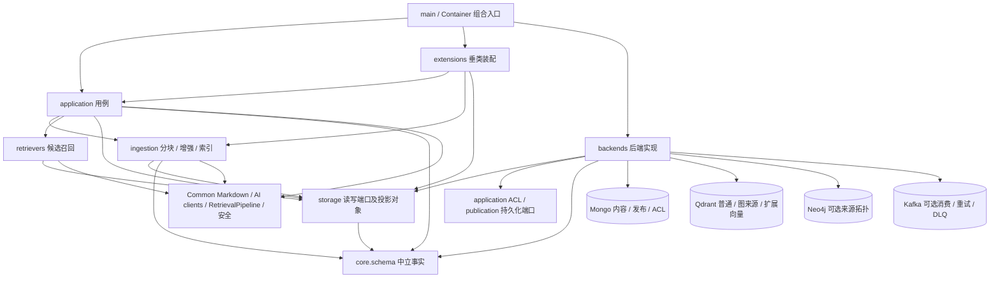
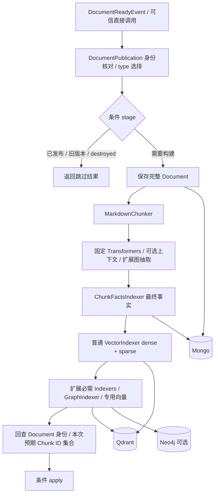
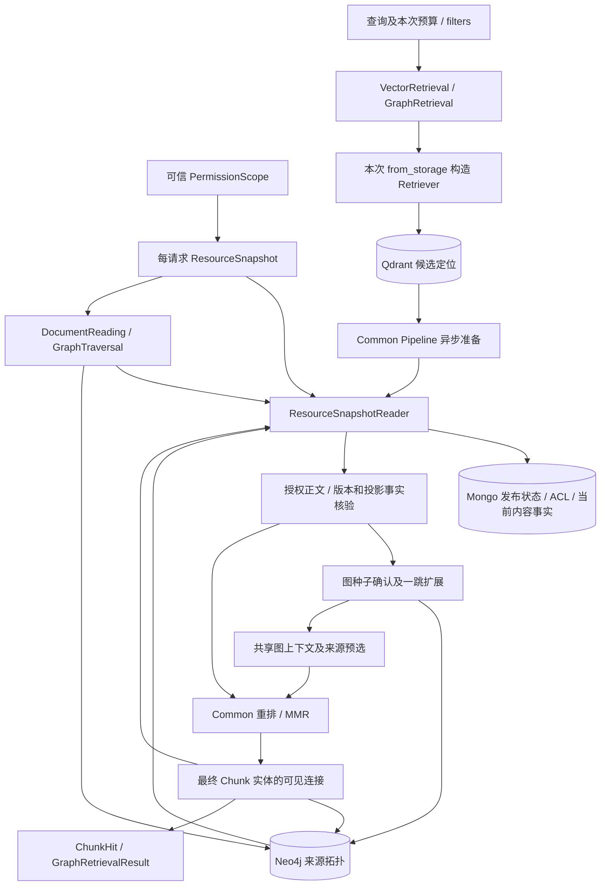
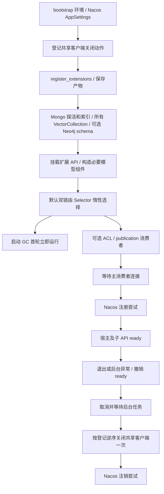

# 实际架构

本图依据当前 [Container](../src/rag/container.py)、[main](../src/rag/main.py) 和 application 实现。术语见[模型](models.md)、[抽象](abstractions.md)；图中出现的存储是实际装配对象，Neo4j、Contextualizer、Kafka 和扩展按配置启用。

## 1. 模块职责与依赖

实线表示组合或消费方向；backends 实现 storage 和应用拥有的持久化端口。

core.schema 不依赖 ingestion、application 或具体数据库。Common 提供 Markdown 与检索算法；RAG 不复用旧 Repository/插件 runtime。配置加载属于正常入口，离线脚本自行组合现有组件。

## 2. 发布与投影

默认链没有图阶段。GraphIndexer 在一个组件内写拓扑和实体/关系来源向量；额外阶段顺序由扩展固定。全部必需阶段成功才 apply，失败保留旧 applied 与部分写入。详见[发布用例](usecases-publication.md)。

## 3. 查询与授权证据

向量查询直接把授权 Chunk 送入排序；图查询先确认种子再组装授权证据。拓扑返回的新来源仍需 Mongo 授权回查，循环表示来源读取而非自动多跳。GraphTraversal 不调用模型；DocumentReading 只通过 Reader 读取完整 Document。详情见[向量](usecases-vector.md)、[图](usecases-graph.md)及[阅读](usecases-reading.md)。

## 4. 平台生命周期

首轮 GC 不参与就绪等待；Nacos 注册失败记录后仍可 ready。Kafka 关闭时连接等待为空，GC 仍启动。pipeline_with_context/pipeline_without_context 是平台共享链，默认 pipeline 按 ENABLE_CONTEXTUALIZE 选择；扩展可以显式选另一条或自行组合。

永久销毁先撤销发布可见性，GC 后续清理所有已配置向量、拓扑、ACL 和内容，永久标记保留。离线 repair 是独立维护入口，不属于 lifespan，也不会改变发布状态。配置与操作见[运行说明](deployment.md)、[GC](usecases-gc.md)和[运维手册](operations.md)。
