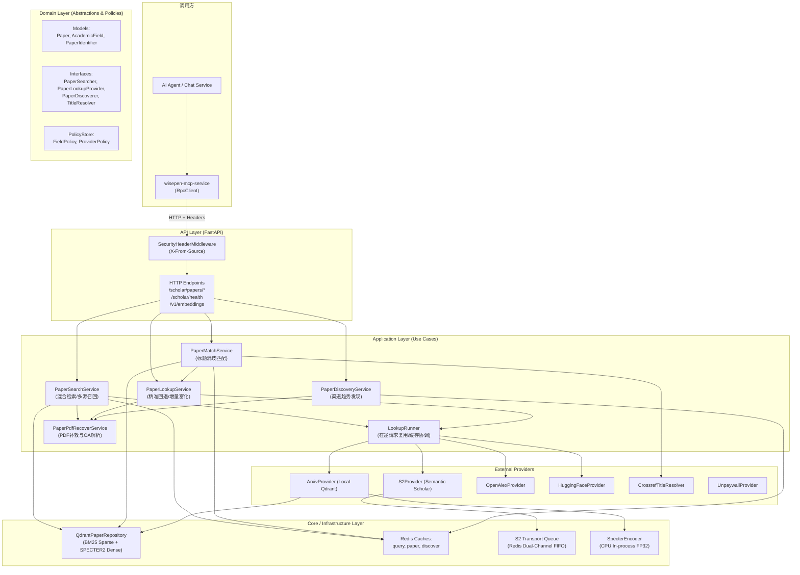

# WisePen Scholar Service 文档库

WisePen Scholar Service 是 WisePenCloud-AI 体系下的学术文献核心微服务。它为上层 AI Agent（通过 `wisepen-mcp-service` 工具集）提供统一、高可用、低时延的论文混合检索、精准标识符查询、完整标题消歧匹配以及学术社区热点发现能力。

本文档库以**当前代码库实际实现**为基准，建立持续维护的技术规范与知识地图。

---

## 一、 文档库知识地图 (Documentation Map)

| 专题文档 | 核心内容概要 | 适用场景 |
|---|---|---|
| [系统架构与核心抽象 (`architecture.md`)](architecture.md) | Clean/六边形分层架构、Container 依赖装配、生命周期与启动预热、核心领域实体（`Paper`, `AcademicField`, `PaperIdentifier`）与端口契约 | 系统设计、核心模型扩展、生命周期排查 |
| [业务用例深度解析 (`usecases.md`)](usecases.md) | Search、Lookup、Match、Discover 四大 Application 用例的端到端调用链、执行状态编排、短路回退、BYOK 凭证处理及 PDF 补救 | 理解业务编排、排查查询流程与错误流转 |
| [HTTP 接口服务规范 (`http-service.md`)](http-service.md) | 全部 HTTP 接口契约（URL、Method、Header、Request/Response JSON）、`R<T>` 响应封包、异常与 HTTP 状态码映射（400/422/429/503/504） | 前端/网关/MCP 对接、接口联调与错误排查 |
| [新增 Provider 开发指南 (`provider-guide.md`)](provider-guide.md) | 完整实战教程：从实现 Domain 端口、配置 ProviderPolicy、字段映射、依赖注入装配到 Nacos 动态策略生效与单测验证 | 接入新学术数据源（如 PubMed、Semantic Scholar、Crossref 等） |
| [混合检索与模型运行时 (`retrieval-and-models.md`)](retrieval-and-models.md) | Qdrant 原生 BM25 稀疏检索 + 768维 SPECTER2 欧氏距离稠密向量、同进程 CPU 编码路由、RRF 融合与有界引用加分公式 | 调优检索召回率、模型与向量算法维护 |
| [缓存架构与配额管理 (`caching-and-quotas.md`)](caching-and-quotas.md) | query / paper / discover 三级 Redis 缓存边界与 TTL、标题规范化索引、S2 跨进程合流双通道队列（NOKEY $\rightarrow$ 429 $\rightarrow$ KEY） | 缓存命中分析、配额限流排查、Redis 运维 |
| [V2 演化路线规划 (`v2-roadmap.md`)](v2-roadmap.md) | 承接 TODO：基于 LightGBM / LambdaMART 的学习排序（LTR）、S2 弱标注训练集采集、离线评估基准建设 | 后续版本功能规划与算法升级 |

### 现役运维与依据文件
- [Nacos 平台配置模板 (`platform-settings.yaml`)](platform-settings.yaml)：生产与开发环境 `SCHOLAR_POLICIES` 及基础参数模板。
- [服务运行与部署说明 (`deployment.md`)](deployment.md)：单机启动、环境变量与部署容器注意事项。
- [离线任务监控看板 (`offline-dashboard.md`)](offline-dashboard.md)：离线导入、全量向量灌库的本地监控看板使用。
- [论文集合的内存缓存 (`qdrant-memory.md`)](qdrant-memory.md)：Qdrant 向量 mmap 预热与内存分层参数配置。
- [SPECTER2 欧氏距离依据 (`specter2-distance-evidence.md`)](specter2-distance-evidence.md)：SPECTER2 官方模型卡与 SciRepEval 评测代码的 L2 选型论证。
- [历史归档目录 (`archive/`)](archive/)：包含 P0~P6 阶段验收记录、旧版计划及历史数据基线快照。

---

## 二、 系统架构全景



---

## 三、 快速启动与本地开发

### 1. 依赖与环境安装
本服务采用 `uv` 进行依赖管理与虚拟环境同步：

```powershell
# 进入当前服务目录
cd d:\WisePenCloud-AI\wisepen_common\WisePenCloud-AI\services\wisepen-scholar-service

# 同步工作区依赖及 test extra
uv sync --inexact --package wisepen-scholar-service --extra test
```

### 2. 配置准备
复制环境配置文件模板：
```powershell
cp .env.example .env
```
配置 `.env` 中的核心变量（如 Nacos 地址、Redis URL、Qdrant URL、服务凭证等）。
若在本地不连接 Nacos，可配置 `NACOS_ENABLED=false`，服务将直接从 `.env` 和进程环境中读取配置。

### 3. 启动服务
```powershell
uv run --no-sync python -m scholar.main
```
服务将在 `127.0.0.1:19916` 启动，并在启动阶段执行：
1. 模型加载：加载 SPECTER2 查询端编码器（FP32 CPU 单进程）。
2. 启动预热：执行一次端到端真实混合检索（`machine learning`，计算机科学领域），覆盖 Qdrant 检索与向量编码。
3. 动态配置监听与 Nacos 实例注册。

### 4. 就绪探针
- 学术服务健康检查：`GET http://127.0.0.1:19916/scholar/health`（校验 Redis ping 与 Qdrant 别名存在性，就绪返回 200，未就绪返回 503）。
- 向量编码健康检查：`GET http://127.0.0.1:19916/health`（返回查询编码模型就绪状态）。

### 5. 运行单测
```powershell
uv run --no-sync python -m pytest tests -q
```
