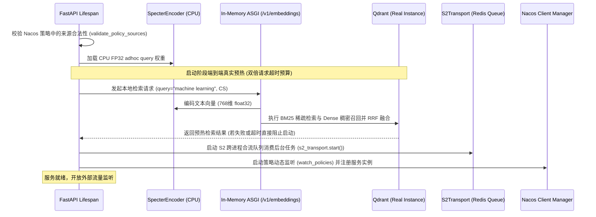

# 系统架构、分层契约与核心抽象

WisePen Scholar Service 严格遵循**整洁架构（Clean Architecture）/ 六边形架构（Hexagonal Architecture）** 模式。业务核心与外部框架、数据库、三方 HTTP API 彻底解耦，依赖方向自外向内单向依赖。

---

## 一、 分层架构总览

```mermaid
flowchart TD
    subgraph LayerAPI["1. API Layer (接入层)"]
        Router["FastAPI Router\n(api/router.py)"]
        Endpoints["Endpoints\n(api/endpoints/papers.py, health.py, embeddings.py)"]
        Schemas["Pydantic Schemas\n(api/schemas/papers.py)"]
    end

    subgraph LayerApp["2. Application Layer (用例编排层)"]
        SearchUC["PaperSearchService\n(application/search.py)"]
        LookupUC["PaperLookupService\n(application/lookup.py)"]
        MatchUC["PaperMatchService\n(application/match.py)"]
        DiscoverUC["PaperDiscoveryService\n(application/discovery.py)"]
        Runner["LookupRunner\n(application/lookup_runner.py)"]
        Projection["PaperProjection\n(application/paper_projection.py)"]
        PDFRecover["PaperPdfRecoverService\n(application/pdf_recover.py)"]
    end

    subgraph LayerDomain["3. Domain Layer (核心领域层)"]
        Models["领域模型\nPaper, AcademicField, PaperIdentifier"]
        Interfaces["能力端口 (Interfaces)\nPaperSearcher, PaperLookupProvider,\nPaperDiscoverer, TitleResolver"]
        Policies["策略契约 (Policies)\nFieldPolicy, ProviderPolicy, ScholarPolicyStore"]
        RepoPorts["仓储端口\nLocalPaperRepository, PaperCacheRepository"]
    end

    subgraph LayerCore["4. Core & Infrastructure Layer (基础设施与适配器)"]
        QdrantStorage["QdrantPaperRepository\n(core/storage/qdrant/)"]
        RedisStorage["RedisPaperCache / RedisQueryCache\n(core/storage/redis/)"]
        ProvidersImpl["三方供应商适配器\nArxivProvider, S2Provider, OpenAlexProvider,\nHuggingFaceProvider, CrossrefTitleResolver, UnpaywallProvider"]
        ModelRT["SpecterEncoder\n(ml/specter.py)"]
        Config["配置中心\nAppSettings, BootstrapSettings, Nacos"]
    end

    LayerAPI --> LayerApp
    LayerApp --> LayerDomain
    LayerCore -->|实现端口| LayerDomain
    LayerApp -->|通过依赖注入调用端口| LayerCore
```



### 层次职责划分与依赖规则
1. **API 层 (`src/scholar/api/`)**：
   - 负责 HTTP 协议适配、Header 参数提取（如各供应商的 BYOK 凭证）、请求体 Schema 校验（`api/schemas`）以及将结果包装为公共 `R<T>` 响应封包。
   - **严禁包含业务编排逻辑**；不维护任何持久化状态。
2. **Application 层 (`src/scholar/application/`)**：
   - 实现业务用例（Search, Lookup, Match, Discover）。
   - 协调领域端口、管理执行超时预算（Budget Control）、处理多源归并与 RRF 融合、调用 PDF 补救以及执行最终的模型输出投影。
   - `lookup_runner.py` 是内部通用执行引擎，负责管理精准查询的在途请求合并、通用链短路与领域增量补全。
3. **Domain 层 (`src/scholar/domain/`)**：
   - **零外部技术依赖**（仅依赖 Python 标准库与轻量基础类型），系统的纯净核心。
   - 定义核心实体（`Paper`）、值对象（`PaperIdentifier`, `AcademicField`）、策略模型（`FieldPolicy`, `ProviderPolicy`）与能力端口（`PaperSearcher`, `PaperLookupProvider`, `PaperDiscoverer` 等）。
4. **Core / Infrastructure 层 (`src/scholar/core/` & `src/scholar/ml/`)**：
   - 领域端口的外部适配实现。
   - 包含 Qdrant 混合检索仓储、Redis 缓存与队列实现、第三方学术 API 适配器（arXiv, Semantic Scholar, OpenAlex, HuggingFace, Crossref, Unpaywall）、SPECTER2 本地模型运行时以及 Nacos 配置中心拉取。

---

## 二、 依赖注入装配 (`src/scholar/container.py`)

系统使用 `dependency_injector` 库进行统一的声明式 IoC（控制反转）装配，所有跨层依赖在 `Container` 中统一管理：

```python
class Container(containers.DeclarativeContainer):
    config = providers.Configuration()
    policy_store = providers.Dependency(instance_of=ScholarPolicyStore)

    # 1. 外部连接与客户端（全部为 Singleton，生命周期与进程相同）
    qdrant = providers.Singleton(AsyncQdrantClient, ...)
    redis = providers.Singleton(Redis.from_url, ...)
    openalex_http = providers.Singleton(httpx.AsyncClient, ...)
    huggingface_http = providers.Singleton(httpx.AsyncClient, ...)
    s2_http = providers.Singleton(httpx.AsyncClient, ...)
    crossref_http = providers.Singleton(httpx.AsyncClient, ...)
    unpaywall_http = providers.Singleton(httpx.AsyncClient, timeout=5)

    # 2. 本地 Embedding 客户端
    embedding_api = providers.Singleton(AsyncOpenAI, base_url="http://127.0.0.1:19916/v1", ...)
    embedding_client = providers.Singleton(EmbeddingClient, client=embedding_api, ...)

    # 3. 仓储与缓存层
    paper_cache = providers.Singleton(RedisPaperCache, redis=redis, ...)
    query_cache_repository = providers.Singleton(RedisQueryCacheRepository, ...)
    discovery_cache_repository = providers.Singleton(RedisDiscoveryCacheRepository, ...)
    paper_repository = providers.Singleton(QdrantPaperRepository, client=qdrant, ...)

    # 4. 供应商能力绑定 (Bindings)
    # 按能力暴露给 Application 层，Application 不需要知道具体的底层供应商实现类
    search_bindings = providers.Dict(
        arxiv=providers.Factory(SearchBinding, searcher=arxiv_searcher, ...),
        openalex=providers.Factory(SearchBinding, searcher=openalex_searcher, requires_byok=True),
        huggingface=providers.Factory(SearchBinding, searcher=huggingface_provider, requires_byok=True),
    )
    lookup_bindings = providers.Dict(
        arxiv=providers.Factory(LookupBinding, provider=arxiv_searcher, rules=PROVIDER_POLICIES["arxiv"]),
        s2=providers.Factory(LookupBinding, provider=s2_provider, rules=PROVIDER_POLICIES["s2"]),
        openalex=providers.Factory(LookupBinding, provider=openalex_searcher, rules=PROVIDER_POLICIES["openalex"]),
        huggingface=providers.Factory(LookupBinding, provider=huggingface_provider, rules=PROVIDER_POLICIES["huggingface"]),
    )
    discovery_bindings = providers.Dict(huggingface=huggingface_provider)

    # 5. 应用用例服务组装
    paper_search_service = providers.Singleton(PaperSearchService, ...)
    paper_lookup_service = providers.Singleton(PaperLookupService, ...)
    paper_match_service = providers.Singleton(PaperMatchService, ...)
    paper_discovery_service = providers.Singleton(PaperDiscoveryService, ...)
```

---

## 三、 生命周期与启动预热 (`src/scholar/main.py`)

为了保证线上高并发检索的平稳性并避免冷启动超时，服务在 FastAPI 的 `lifespan` 中执行严格的依赖预热与验证流程：



### 关键生命周期保障机制
1. **双倍预算预热容错**：Qdrant 磁盘 mmap 与本地模型首次查询冷读取开销较大，启动预热分配了 $2 \times \text{SCHOLAR\_REQUEST\_TIMEOUT\_SECONDS}$（默认 50 秒）的充裕时间。
2. **完整混合链路强制校验**：预热必须确认向量编码与 Qdrant 检索均成功；若出现降级为纯文本检索（`partial_error` 不为空），服务会拒绝启动，避免带病上线。
3. **安全关闭（Graceful Shutdown）**：在退出时先从 Nacos 注销实例切断流量，再依次关闭 S2 传输队列、各三方 HTTP 连接池、Qdrant 客户端与 Redis 连接池。

---

## 四、 核心领域模型与实体

### 1. 论文核心实体 (`Paper`)
定义于 `src/scholar/domain/models/paper.py`：
- `arxiv_id`: 标准化的 arXiv 编号（如 `"2301.12345"`）。
- `doi`: 标准化 DOI（小写、移除 URL 前缀）。
- `title`: 论文原标题。
- `abstract`: 论文摘要。
- `authors`: 作者姓名列表（`list[str]`）。
- `publication_date`: 首次发表日期（`date`）。
- `year`: 发表年份（`int`）。
- `url`: 官方落地页链接。
- `pdf_url`: 可用的直接 PDF 下载入口。
- `source`: 基础来源标识（`PaperSource` 枚举：`ARXIV`, `S2`, `OPENALEX`, `HUGGINGFACE` 等）。
- `metadata`: 来源独立命名空间字典（`dict[str, Any]`）。例如 `metadata["arxiv"]`、`metadata["s2"]`、`metadata["huggingface"]`，各来源独立记录，严禁将不同来源的引用量等指标粗暴累加。

### 2. 论文身份标识 (`PaperIdentifier`)
定义于 `src/scholar/domain/models/identifiers.py`：
- `kind`: 标识种类枚举 `IdentifierKind`（`ARXIV`, `DOI`, `OPENALEX`, `S2_PAPER_ID`, `S2_CORPUS_ID`, `URL`）。
- `value`: 原始标识字符串。
- `normalized_value()`: 自动化归一化逻辑（如自动识别 arXiv URL/前缀并剥离版本后缀 `v1`、小写化 DOI、提取 OpenAlex W 编号等）。

### 3. 学术领域分类 (`AcademicField`)
定义于 `src/scholar/domain/models/fields.py`，系统支持 13 个标准领域：
- `GENERAL`（通用跨学科）
- `COMPUTER_SCIENCE`（计算机科学）
- `MEDICINE`（医学与临床）
- `BIOLOGY`（生命科学与生物）
- `ENGINEERING`（工程与电气系统）
- `ECONOMICS_BUSINESS`（经济与商科）
- `MATHEMATICS`（数学与统计）
- `PHYSICS`（物理与天文）
- `CHEMISTRY`（化学）
- `PSYCHOLOGY`（心理与认知）
- `SOCIAL_SCIENCES`（社会科学）
- `ARTS_HUMANITIES`（人文艺术）
- `LAW`（法学）
- `MATERIALS_ENVIRONMENTAL_SCIENCES`（材料与环境）

### 4. 领域策略契约 (`FieldPolicy` & `ProviderPolicy`)
- **`FieldPolicy`**：定义特定领域内的执行管线：
  - `searchers`: 有序检索来源列表（顺序即优先级，如 CS 为 `["arxiv", "huggingface"]`）。
  - `field_enrichers`: 领域增量富化来源列表（如 CS 为 `["huggingface"]`）。
  - `discoverer`: 渠道发现来源（如 CS 为 `"huggingface"`）。
- **`ProviderPolicy`**：定义特定供应商的数据处理行为：
  - `extract_identifiers(paper)`: 从论文提取该供应商能识别的标识集合。
  - `is_complete(paper)`: 判断当前获取到的论文是否已包含完整详情（避免多余网络请求）。
  - `project_metadata(metadata)`: 裁剪并提取面向大模型的紧凑精炼元数据。
  - `pdf_url(paper)`: 提取该来源提供的直接 PDF 阅读地址。

---

## 五、 核心端口规范 (Domain Interfaces)

Domain 层定义了 4 个主要能力端口，位于 `src/scholar/domain/interfaces/`：

1. **`PaperSearcher` (`paper_searcher.py`)**：
   ```python
   class PaperSearcher(ABC):
       @abstractmethod
       async def search(
           self,
           query: str,
           field: AcademicField,
           published_after: date | None,
           published_before: date | None,
           limit: int,
       ) -> SearcherResult:
           """执行关键词或混合检索，返回有序候选论文列表。"""
   ```
2. **`PaperLookupProvider` (`paper_lookup.py`)**：
   ```python
   class PaperLookupProvider(ABC):
       @abstractmethod
       async def lookup(
           self, identifiers: list[PaperIdentifier]
       ) -> list[PaperLookupMatch]:
           """按标识符批量查询论文，逐项保留输入顺序与未找到状态。"""
   ```
3. **`PaperDiscoverer` (`paper_discoverer.py`)**：
   ```python
   class PaperDiscoverer(ABC):
       @abstractmethod
       async def discover(
           self,
           field: AcademicField,
           period: Literal["daily", "weekly", "monthly"],
           sort: Literal["recent", "trending"],
           limit: int,
       ) -> DiscovererResult:
           """获取指定领域和时间窗口的社区发现/热门文献。"""
   ```
4. **`TitleResolver` (`title_resolver.py`)**：
   ```python
   class TitleResolver(ABC):
       @abstractmethod
       async def resolve_titles(
           self, titles: list[str]
       ) -> dict[str, TitleResolution]:
           """将完整论文标题精确解析为权威 DOI。"""
   ```
