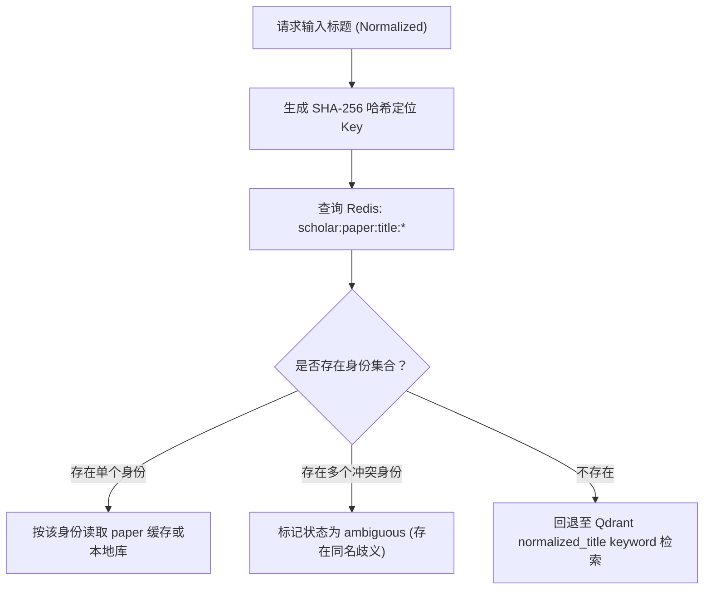
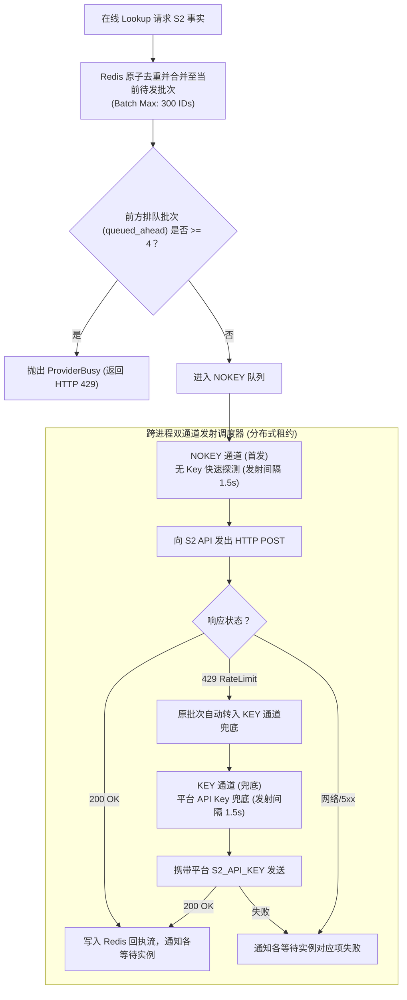

# 缓存架构与配额管理 (Caching & Quotas)

WisePen Scholar Service 依赖 Redis 作为全局集中式的状态协调器，承载**三级业务缓存**与**高风险外部依赖（Semantic Scholar）的双通道跨进程配额队列**。

---

## 一、 三级业务缓存边界

所有业务缓存均位于 `scholar:*` 命名空间下，严格按三种业务边界隔离：

| 缓存边界 | 存储内容 | 默认 TTL | 隔离粒度与设计语义 |
|---|---|---|---|
| **`query`** | 检索候选论文快照及其原始打分顺序 | **600 秒** (10 分钟) | 按 `[collection_alias, hash(query, field, dates, model_revision)]` 隔离；缓存不随用户 `limit` 变化，命中后由应用层动态截断并重新组装执行状态 |
| **`paper`** | 来源完整的论文事实（未投影）、确认未找到状态、标题身份索引及 Unpaywall 结果 | **86400 秒** (24 小时) | 确认找到与确认未找到（404）均采用 24 小时缓存；网络超时与断连等瞬态错误**严禁写入缓存**；旧版本凭证隔离键自然过期，不进行冗余迁移 |
| **`discover`** | 社区趋势发现文献列表及渠道窗口信息 | **900 秒** (15 分钟) | 按 `[collection_alias, field, period, sort, limit]` 隔离；跨用户和凭证共享 |

### 1. 缓存与凭证准入（BYOK 防白嫖）
- 缓存事实本身跨用户和凭证共享（学术论文是客观中立事实）。
- **BYOK 鉴权先于缓存读取**：对于要求 BYOK 的来源（如 HuggingFace、OpenAlex 检索），系统首先校验本次请求是否携带对应 Key。若未携带，直接将该来源标记为 `not_executed` 并跳过，**严禁绕过凭证直接消费缓存**。

### 2. 尽力写入与超时保护
缓存的读取和写入均受当前请求剩余超时预算的保护。当请求接近超时或 Redis 发生抖动时，缓存写入失败仅记警告日志，**绝不会丢弃已取得的论文数据，也不会把成功的业务响应改写为失败**。

---

## 二、 完整标题身份索引 (`RedisPaperCache`)

为加速完整标题的消歧匹配，避免高频请求 Qdrant 与 Crossref，系统在 `paper` 边界下维护了轻量级的**标题身份倒排索引**：

- **预热机制**：`search` 和 `lookup` 获取到新论文事实并写入缓存时，会自动提取标准化标题并异步预热该索引，实现后续查询的零成本命中。
- **纯身份索引**：该索引只缓存论文标识符（如 DOI、arXiv ID），不存储正文 JSON。完整论文事实仍然受 `paper` 缓存的生命周期管理。

---

## 三、 S2 双通道跨进程合流队列 (`S2Transport`)

Semantic Scholar（S2）Graph API 是全平台共享的关键外部依赖，具有严格的并发限制（批量最大 500 项，默认 300 项）与频率限制。系统通过 Redis 实现跨微服务实例的统一合流与双通道调度。

### 1. 核心运行参数
- `SCHOLAR_S2_BATCH_MAX_IDS = 300`：每批最大聚合 ID 数量（支持 1~500 配置）。
- `SCHOLAR_S2_NOKEY_INTERVAL_SECONDS = 1.5`：无 Key 探测通道的最小发射时间间隔。
- `SCHOLAR_S2_KEY_INTERVAL_SECONDS = 1.5`：平台 Key 通道的最小发射时间间隔。
- `SCHOLAR_S2_MAX_QUEUED_AHEAD = 3`：前方允许排队的最大批次数（队长阈值）。

### 2. 在线准入控制 (Admission Control)
当在线请求到达时，系统检查当前队列前方已排队的批次数：
- 若前方批次数 $< 4$（即 $\le 3$），允许入队等待。
- 若前方批次数 $\ge 4$，立刻拒绝准入，抛出 `ProviderBusy`（客户端感知为 HTTP 429），**防止队列雪崩与请求在服务端积压超时**。
- 合入已有在途批次的操作不额外占用排队项数。

### 3. 用户 BYOK 独立通道
当用户在 HTTP Header 中提供了 `X-S2-Api-Key` 时：
- 请求直接进入按该 Key SHA-256 指纹隔离的私有 FIFO 队列。
- **不参与平台队列合流，不受队长准入阈值限制**，享受独立专属的高速通道。
