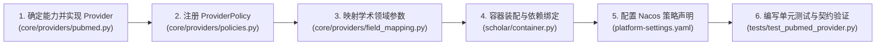

# 新增 Provider 扩展实战指南

WisePen Scholar Service 采用了基于能力端口（Port）与策略注册（Policy）的可扩展插件化架构。当需要接入一个新的学术数据源（例如 PubMed、Crossref、Web of Science 或机构私有文献库）时，**核心检索、编排、缓存与融合流程无需做任何修改**，只需按规范完成 Provider 适配、策略注册与容器装配。

本文以接入假想的 **`PubMedProvider`**（医学领域学术数据源）为例，提供从零到一的完整开发步骤。

---

## 一、 开发全流程概览



---

## 二、 步骤详解

### 步骤 1：确定能力端口并在 `core/providers/` 下实现 Provider
根据新数据源支持的实际能力，选择实现 `src/scholar/domain/interfaces/` 下的一个或多个抽象基类：
- **`PaperSearcher`**：支持基于关键词/主题的主题检索。
- **`PaperLookupProvider`**：支持基于标识符（PMID、DOI）的精准查询与元数据富化。
- **`PaperDiscoverer`**：支持期刊、趋势等渠道发现。

新建文件 `src/scholar/core/providers/pubmed.py`：

```python
"""PubMed 学术数据源适配器。"""

from __future__ import annotations
from datetime import date
import httpx

from scholar.domain.errors import ProviderError, ProviderBusy
from scholar.domain.interfaces.paper_searcher import PaperSearcher, SearcherResult
from scholar.domain.interfaces.paper_lookup import PaperLookupProvider, PaperLookupMatch
from scholar.domain.models.fields import AcademicField
from scholar.domain.models.identifiers import PaperIdentifier, IdentifierKind
from scholar.domain.models.paper import Paper, PaperSource


class PubMedProvider(PaperSearcher, PaperLookupProvider):
    def __init__(self, http: httpx.AsyncClient, api_key: str | None = None) -> None:
        self._http = http
        self._api_key = api_key

    async def search(
        self,
        query: str,
        field: AcademicField,
        published_after: date | None,
        published_before: date | None,
        limit: int,
    ) -> SearcherResult:
        try:
            # 1. 组装请求参数与日期过滤
            params = {"term": query, "retmax": limit}
            if self._api_key:
                params["api_key"] = self._api_key

            response = await self._http.get("https://eutils.ncbi.nlm.nih.gov/entrez/eutils/esearch.fcgi", params=params)
            response.raise_for_status()
            
            # 2. 解析为标准领域实体 Paper
            papers: list[Paper] = self._parse_search_response(response.json())
            return SearcherResult(papers=papers)
        except httpx.HTTPStatusError as exc:
            if exc.response.status_code == 429:
                raise ProviderBusy("PubMed rate limit exceeded") from exc
            raise ProviderError(f"PubMed HTTP error: {exc.response.status_code}") from exc
        except (httpx.RequestError, TimeoutError) as exc:
            raise ProviderError(f"PubMed network failed: {exc}") from exc

    async def lookup(
        self, identifiers: list[PaperIdentifier]
    ) -> list[PaperLookupMatch]:
        results: list[PaperLookupMatch] = []
        # 按输入 identifiers 批量查询，逐项返回 PaperLookupMatch(identifier=..., paper=..., error=...)
        # 必须严格保持输入顺序
        return results
```

> [!IMPORTANT]
> **异常处理准则**：
> 1. 外部 429 限流或队列打满必须抛出 `ProviderBusy`（系统将向客户端映射 429 状态码）。
> 2. 其它已知网络与 HTTP 错误统一用 `ProviderError` 包裹原异常（保留 `from exc`），保留真实原因。
> 3. 严禁静默吞掉异常或把空结果冒充成功。

---

### 步骤 2：定义并注册 `ProviderPolicy`
在 `src/scholar/core/providers/policies.py` 中注册新数据源的生命周期与元数据规则：

```python
# src/scholar/core/providers/policies.py

def project_pubmed_metadata(metadata: dict[str, Any]) -> dict[str, Any]:
    """精炼模型可见的元数据（剔除内部冗余字段）。"""
    raw = metadata.get("pubmed", {})
    return {
        key: raw[key]
        for key in ("pmid", "mesh_terms", "clinical_trials", "journal")
        if raw.get(key)
    }

def is_pubmed_complete(paper: Paper) -> bool:
    """判断该论文是否已包含完整详情（若已有 mesh_terms 则无需重复增量查详情）。"""
    pm_data = paper.metadata.get("pubmed")
    return bool(pm_data and "mesh_terms" in pm_data)

PROVIDER_POLICIES["pubmed"] = ProviderPolicy(
    source="pubmed",
    extract_identifiers=lambda paper: {
        PaperIdentifier(IdentifierKind.DOI, paper.doi)
    } if paper.doi else set(),
    is_complete=is_pubmed_complete,
    project_metadata=project_pubmed_metadata,
    pdf_url=lambda paper: paper.metadata.get("pubmed", {}).get("pdf_url"),
)
```

---

### 步骤 3：配置领域映射（如适用）
若该数据源使用自有的分类编码体系（例如 PubMed MeSH 类别或 OpenAlex 概念 ID），在 `src/scholar/core/providers/field_mapping.py` 中补充标准 `AcademicField` 到该数据源专有参数的映射字典。

---

### 步骤 4：在 `src/scholar/container.py` 中装配依赖

在声明式容器中添加该 Provider 的连接与绑定：

```python
# src/scholar/container.py

class Container(containers.DeclarativeContainer):
    ...
    # 1. 声明专用的 HTTP 客户端
    pubmed_http = providers.Singleton(
        httpx.AsyncClient, timeout=config.SCHOLAR_REQUEST_TIMEOUT_SECONDS
    )

    # 2. 实例化 Provider
    pubmed_provider = providers.Singleton(
        PubMedProvider,
        http=pubmed_http,
        api_key=config.PUBMED_API_KEY,
    )

    # 3. 注册到搜索能力绑定字典
    search_bindings = providers.Dict(
        arxiv=...,
        openalex=...,
        huggingface=...,
        pubmed=providers.Factory(
            SearchBinding,
            searcher=pubmed_provider,
            requires_byok=False, # 若支持平台 key 则为 False
        ),
    )

    # 4. 注册到精准查询与增量富化绑定字典
    lookup_bindings = providers.Dict(
        arxiv=...,
        s2=...,
        openalex=...,
        huggingface=...,
        pubmed=providers.Factory(
            LookupBinding,
            provider=pubmed_provider,
            cache=paper_cache,
            rules=PROVIDER_POLICIES["pubmed"],
        ),
    )
```

---

### 步骤 5：在 Nacos / `platform-settings.yaml` 中声明策略
新增的 Provider 无需任何硬编码路由，完全由 `SCHOLAR_POLICIES` 声明式调度。

编辑 `docs/platform-settings.yaml`（及 Nacos 中的配置）：
```yaml
SCHOLAR_POLICIES:
  medicine:
    # 检索顺序：优先 PubMed，失败后回退至 OpenAlex
    searchers:
      - pubmed
      - openalex
    # 增量富化器：取得基础论文后，补充 PubMed 临床元数据
    field_enrichers:
      - pubmed
    discoverer: null
```

> [!TIP]
> **热更新生效**：修改并发布 Nacos 配置后，`watch_policies` 监听器会在几毫秒内热加载新策略，**无需重启微服务进程**。

---

### 步骤 6：编写测试验证

在 `tests/test_pubmed_provider.py` 中针对该 Provider 编写针对性单测：
1. **Mock HTTP 成功响应**：验证是否能正确解析字段至 `Paper` 领域模型。
2. **Mock 429 限流响应**：验证是否准确抛出 `ProviderBusy`。
3. **Mock 网络超时**：验证是否准确包装为 `ProviderError` 并保留异常链。
4. **验证契约行为**：验证 `is_complete`、`extract_identifiers` 和 `project_metadata` 的白名单裁剪符合预期。

运行测试命令：
```powershell
uv run --no-sync python -m pytest tests/test_pubmed_provider.py -q
```
