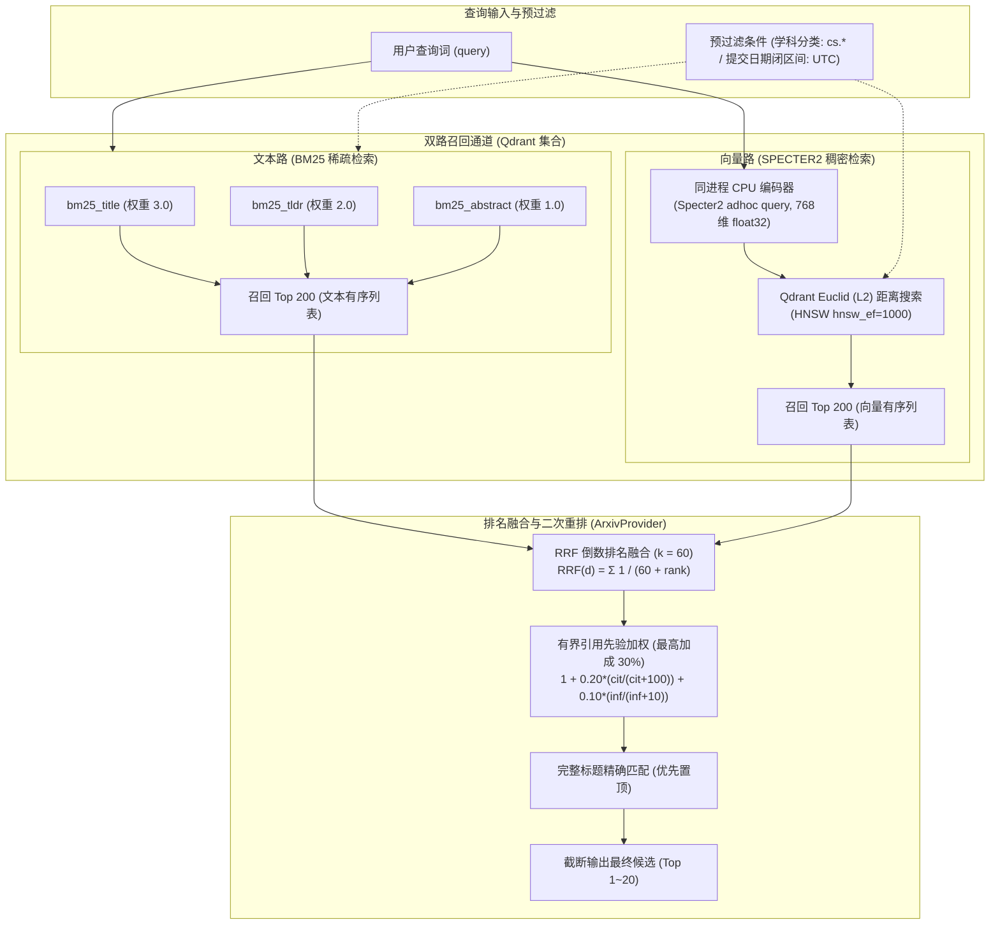

# 混合检索与模型运行时 (Retrieval & Models)

WisePen Scholar Service 采用了 **Qdrant 原生混合检索（Native Hybrid Search）** 方案。在单数据库中同时承载 BM25 稀疏文本检索与 768 维 SPECTER2 稠密向量召回，并通过 **倒数排名融合（RRF）** 结合 **有界引用先验加分** 输出最终排序结果。

---

## 一、 混合检索全景架构



---

## 二、 Qdrant 原生混合检索配置

在当前代码实现（`src/scholar/core/storage/qdrant/paper_repository.py`）中，Qdrant 直接管理稀疏和稠密双路通道：

### 1. BM25 稀疏文本通道
- **三个文本通道及权重比**：
  - `bm25_title`：权重 **3.0**
  - `bm25_tldr`：权重 **2.0**（来自于 S2 TLDR 事实）
  - `bm25_abstract`：权重 **1.0**
- **BM25 参数配置**：
  - 语言分析器：`english`
  - 词频饱和度：`k = 1.2`
  - 长度归一化：`b = 0.75`
  - 集合平均长度：`avg_len = 256.0`

### 2. SPECTER2 稠密向量通道
- **向量维度**：768 维。
- **距离度量**：`Distance.EUCLID`（欧氏距离，非余弦相似度）。
- **向量归一化合同**：`normalize: False`（保留 CLS 原始模长）。
- **模型选型**：
  - 论文离线嵌入：采用 `allenai/specter2_proximity` adapter（输入格式：`title + [SEP] + abstract`，截断 512 tokens）。
  - 在线查询嵌入：采用 `allenai/specter2_adhoc_query` adapter。

---

## 三、 为什么选用欧氏距离 (L2) 而非余弦相似度？

系统在选型时对官方论文与评测基准进行了严格的证据考证（详见 [specter2-distance-evidence.md](specter2-distance-evidence.md)）：

1. **官方三元组损失目标是欧氏距离**：
   AI2 官方技术报告明确指出：预训练三元组损失（Triplet Loss）的目标是缩小查询 $Q$ 到正例 $P^+$ 的**欧氏距离**，并使其小于到负例 $P^-$ 的欧氏距离：
   $$\text{minimize } \max\left(0, d_E(Q, P^+) - d_E(Q, P^-) + \alpha\right)$$
2. **官方评测代码直接按负欧氏距离排序**：
   在官方 SciRepEval 评测套件中，检索评测模块（`evaluation/evaluator.py`）直接采用 `sklearn.metrics.pairwise.euclidean_distances` 计算距离矩阵并取相反数作为排序分：
   ```python
   scores = euclidean_distances(cands, query).flatten()
   run[qid][cid] = float(-scores[i])
   ```
3. **保留原始模长的物理意义**：
   未经单位化的 CLS 向量模长蕴含了文本信息密度与置信度先验。由于未做归一化，L2 距离与余弦相似度的排序不再数学等价，强制改用余弦会破坏模型的预训练表征。

---

## 四、 排名融合与有界引用先验公式

### 1. 倒数排名融合 (RRF)
双路召回各取前 200 篇候选（`SCHOLAR_SEARCH_CANDIDATES = 200`），经 RRF 融合计算基准分：
$$RRF(d) = \sum_{m \in \{\text{sparse}, \text{dense}\}} \frac{1}{k + r_m(d)}$$
其中平滑参数 $k = 60$（`SCHOLAR_SEARCH_RRF_K = 60`），$r_m(d)$ 为文档在对应路中的名次（从 1 开始）。

### 2. 有界引用先验加分 (Bounded Citation Prior)
在 RRF 基础上，乘以基于权威学术信号的非线性加权系数：
$$\text{FinalScore}(d) = RRF(d) \times \left(1 + 0.20 \times \frac{\text{citations}}{\text{citations} + 100} + 0.10 \times \frac{\text{influential\_citations}}{\text{influential\_citations} + 10}\right)$$

- **平滑分母设计**：总引用数基数为 100，高影响引用数基数为 10。
- **严格有界性**：当引用数极大时，加分上限严格约束在 **$30\%$（$+0.30$）以内**，绝不会因为某些几万引用的经典“老古董”论文彻底淹没高度契合的崭新预印本文献。
- **为什么 V1 不引入发表年份作为排序权重？**
  时间先验极易造成冷门领域新论文被粗暴降权或造成新发布论文断崖式下跌。时间边界统一由用户通过 `published_after` 和 `published_before` 进行显式过滤。

---

## 五、 模型运行时与查询编码 (`ml/specter.py`)

### 1. 同进程 CPU 编码架构
为了避免外部独立微服务调用的网络往返开销并简化部署拓扑，查询编码器直接内嵌在主服务进程中：
- 采用 PyTorch 单进程推理，通过 `SCHOLAR_EMBEDDING_CPU_THREADS = 2` 控制 CPU 线程数，防止多请求并发占满 CPU。
- 启动时通过 ASGI 内存通道完成一次完整端到端查询预热。

### 2. 编码降级保护机制
当本地查询编码超时（默认 2 秒）或遇到不可预期的模型错误时：
- 服务自动降级为纯 BM25 文本检索结果。
- 在响应的 `execution` 中打上 `partial` 标记并记录错误原因。
- **该降级结果严禁写入正常 query 缓存**，确保下次请求时能自动重新尝试混合检索。
