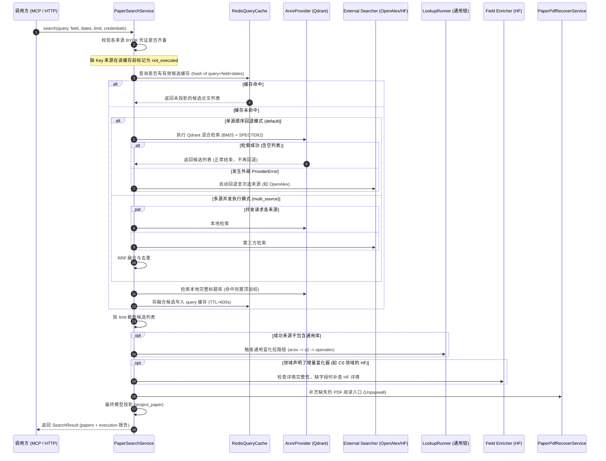
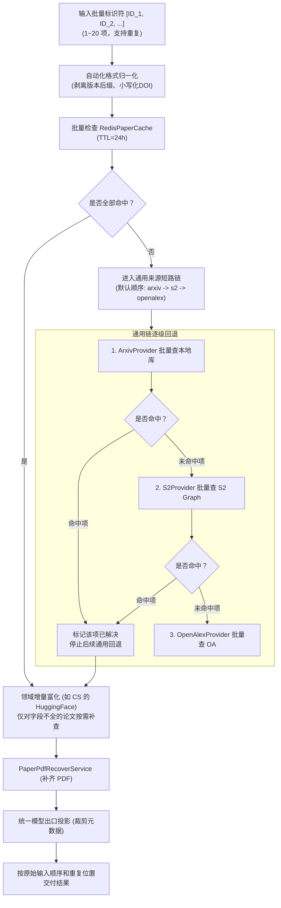
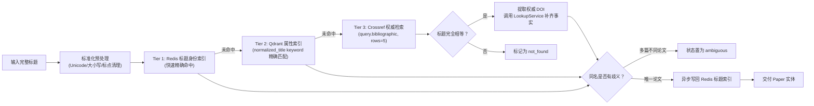

# 业务用例深度解析 (Application Use Cases)

WisePen Scholar Service 的业务编排集中在 `src/scholar/application/` 目录，分为 **Search（检索）**、**Lookup（精确查询）**、**Match（标题消歧匹配）**、**Discover（社区趋势发现）** 四大核心用例。

所有用例均严格管理请求总超时预算（默认 25 秒），执行非阻塞的并发或串行控制，统一调用 PDF 补救并执行最终的模型元数据投影。

---

## 一、 用例一：论文主题检索 (`PaperSearchService`)

### 1. 业务目标
为 AI Agent 提供面向研究主题、关键词、学科限定与发表时间区间的混合召回与多源融合检索。

### 2. 端到端执行流程

### 3. 关键特性与设计原则
1. **BYOK 准入优先**：OpenAlex、HuggingFace 搜索必须携带用户自备凭证（BYOK）。缺少 Key 的来源在**读取缓存之前**即被判定跳过并记录为 `not_executed`；如果该领域没有可用来源，立即返回 503 并提示所需的 Key，避免非授权白嫖缓存。
2. **有序回退 vs 正常空结果**：在 `default` 模式下，来源按 `FieldPolicy.searchers` 顺序回退。**正常的空列表（0篇）视为查询成功，立刻终止**，绝不会因为搜不到就胡乱回退到次级来源导致语义漂移；仅在发生上游网络断连或 5xx 时才触发容灾回退。
3. **完整标题自动置顶**：当用户输入的内容恰好是某篇论文的完整标题时，本地库检索到的精确论文会在 RRF 融合后直接被提升至第 1 位。

---

## 二、 用例二：精准标识符查询 (`PaperLookupService`)

### 1. 业务目标
已知论文稳定标识（DOI, arXiv ID, OpenAlex ID, Semantic Scholar Corpus ID, 官方 URL 等）时，按原顺序批量检索基础论文信息并完成增量字段富化。

### 2. 内部执行核心：`LookupRunner`
`LookupRunner` 是检索后处理与精准查询共享的执行引擎：

### 3. 关键特性与设计原则
1. **通用链短路（Short-circuiting）**：一旦某个通用来源（如本地 arXiv）找到了论文基础事实，该论文就立刻被标记为已解决，**绝不会为了追求引用数或 TLDR 继续请求 S2 或 OpenAlex**，严格控制外部 API 调用成本。
2. **正负缓存一视同仁**：确认找到的论文与确认未找到（404）的标识符均采用 24 小时完整 TTL 缓存；网络断连或超时等临时错误不写缓存，避免负向污染。
3. **保序与容错交付**：返回列表 `items` 与输入的顺序完全一致；单篇论文未找到或上游超时仅标记该项状态为 `failed` 或 `not_found`，绝不因单项失败丢弃其他已成功找到的论文。

---

## 三、 用例三：完整标题消歧匹配 (`PaperMatchService`)

### 1. 业务目标
用户输入一个或多个论文完整标题（非关键词）时，精准定位到具体论文并消歧，防止 LLM 被近似检索带偏。

### 2. 三级消歧解析管线

### 3. 关键特性与设计原则
1. **严格字符等价，禁用近似置信度**：标题匹配要求标准化后的字符必须 $100\%$ 相等，保留副标题与数学符号，严禁使用模糊编辑距离或语义相似度猜测，确保学术严肃性。
2. **并发保护**：Crossref 解析使用进程级共享的信号量 `Semaphore(2)` 控制并发，请求超时设为 5 秒，防止标题批量查询压垮公共学术基础设施。

---

## 四、 用例四：社区趋势发现 (`PaperDiscoveryService`)

### 1. 业务目标
跟踪学术社区（如 HuggingFace Daily/Weekly/Monthly Papers）的最新趋势产物、点赞排行与关联开源模型/数据集。

### 2. 执行机制与设计规范
1. **零关键词输入**：发现用例不接受 `query` 参数，完全依据社区官方频道的分发信号（Trending / Recent）进行拉取。
2. **时间周期透传**：
   - `daily`: 使用官方上游最新发布的自然日内容。
   - `weekly`: 传当周 UTC ISO 周期参数。
   - `monthly`: 传当月自然月参数。
3. **官方保序交付**：严格保持官方返回的原始热度排序，平台不根据内容日期做二次丢弃或过滤；同样通过 `PaperPdfRecoverService` 补齐 PDF 并应用紧凑投影。
4. **发现缓存**：按 `[field, period, sort, limit]` 为键写入 Redis 独立发现缓存，TTL 默认 15 分钟（900 秒）。
