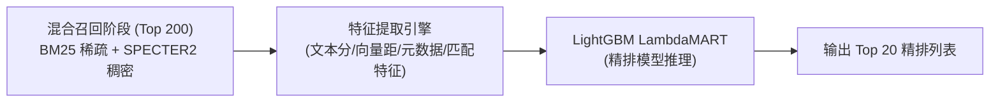

# V2 演化路线规划 (V2 Roadmap)

WisePen Scholar Service V1 版本已全面跑通基于 Qdrant 的原生稀疏+稠密混合检索、RRF 融合与有界引用先验加分机制。本文档承接原 `TODO.md` 规划，系统化阐述 V2 阶段的核心演化目标——**基于机器学习的学术排序学习（Learning to Rank, LTR）与评测基准体系**。

---

## 一、 V2 核心目标：排序学习 (Learning to Rank)

### 1. 算法选型：LightGBM / LambdaMART
在 V1 中，排序结合了 RRF 排名倒数和基于经验设计的启发式引用加分公式：
$$\text{Score} = RRF \times \left(1 + 0.20 \times \frac{\text{citations}}{\text{citations}+100} + 0.10 \times \frac{\text{influential}}{\text{influential}+10}\right)$$

在 V2 中，系统计划将粗排（Top 200 混合召回）与精排分离，在精排阶段引入 **LambdaMART（基于 LightGBM 实现）** 树模型进行多特征有监督重排。

---

## 二、 弱监督训练数据采集方案

由于学术文献检索领域缺乏大规模人工精标注的相关性标签，V2 拟采用**基于权威学术引擎排名的弱监督标注策略（Weak Supervision）**：

1. **Query 样本池构建**：
   - 从历史调研日志中脱敏抽取，或通过学术分类主题生成覆盖 13 个学术领域的典型检索词，构建包含约 1,000~2,000 个不同学术意图的 Query 集合。
2. **弱标注生成（S2 API Ranking as Teacher）**：
   - 对每个 Query，并发请求 Semantic Scholar API，拉取其官方排序的前 10~20 篇高置信度结果。
   - 以 S2 官方排名的倒数或分档相关度（如 3-极相关、2-高度相关、1-一般相关、0-未召回）作为弱监督相关度标签。
   - 最终采集形成约 **10,000 条 `query-document` 样本对**。

---

## 三、 特征工程设计 (Feature Engineering)

| 特征分组 | 具体特征项 | 物理含义与预期贡献 |
|---|---|---|
| **文本匹配特征** | `score_bm25_title` | 标题 BM25 分数 |
| | `score_bm25_tldr` | 摘要 TLDR BM25 分数 |
| | `score_bm25_abstract` | 摘要正文 BM25 分数 |
| **语义向量特征** | `distance_specter2_l2` | SPECTER2 查询与论文之间的欧氏距离 |
| | `similarity_cosine` | 单位化向量余弦相似度 |
| **混合召回特征** | `rrf_score` | V1 中的 RRF 倒数融合基准分 |
| | `sparse_rank` / `dense_rank` | 候选在稀疏路与稠密路中的原始排位 |
| **学术影响力特征** | `citation_count` | 总引用量 |
| | `influential_citation_count` | 关键/高影响力引用量 |
| | `citation_ratio` | 高影响引用占总引用的比例 |
| **精确匹配先验** | `is_exact_title_match` | 是否存在完整标题完全匹配（布尔值） |
| | `title_phrase_match` | 标题是否包含完整短语 |

---

## 四、 防泄漏数据集划分与评测基准

### 1. 按 Query 严格隔离（Group-by-Query Split）
学术检索模型最常见的过拟合与数据泄漏来自于“同一个 Query 下的某些论文在训练集、另一些在测试集”。
- **数据集划分规则**：必须基于 `query_id` 进行哈希分组切分，划分比例建议为：
  - **训练集 (Train)**：$70\%$
  - **验证集 (Val)**：$15\%$
  - **测试集 (Test)**：$15\%$
- 严禁跨分组打散 `query-document` 对。

### 2. 离线评估指标与上线门槛
在上线前，必须在测试集上与 V1 基准进行严格的指标对比：
- **评估指标**：$\text{nDCG}@5$、$\text{nDCG}@10$、$\text{MAP}$、$\text{MRR}$。
- **准出条件**：
  1. LambdaMART 模型在 Test 集上的 $\text{nDCG}@10$ 必须稳定超过 V1 有界引用先验 baseline $\ge 5\%$。
  2. 模型单次推理耗时（针对 200 篇候选提取特征与打分）必须控制在 **10 毫秒以内**（可转为 C++ 或 ONNX Runtime 执行）。
  3. 严禁出现冷门前沿新预印本被误杀（新论文在测试集的留存率校验）。
